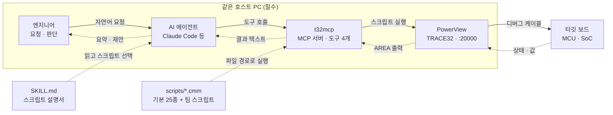

# TRACE32 MCP AI 디버깅 가이드

> **말로 하는 디버깅, TRACE32에서 시작하세요**
>
> Lauterbach가 공개한 TRACE32 MCP 서버(`t32mcp`)를 연결하면, AI 에이전트가 자연어 요청을 받아
> TRACE32를 직접 조작합니다. 반복 조작은 AI에게 맡기고, 엔지니어는 원인을 좁히는 데 집중하세요.

| | |
|---|---|
| **MCP 도구** | 4개 (허용 범위에 따라 2~4개) |
| **기본 스크립트** | 25종 |
| **설치** | 5단계 |
| **라이선스** | Apache-2.0 (오픈소스) |

```text
claude · my-project
───────────────────────────────────────────────────────────
나   sieve 함수에 브레이크포인트 걸고 실행해줘

     1  sw_get_symbols.cmm        sieve
     2  mem_set_breakpoint.cmm    sieve · X
     3  set_running.cmm

AI   sieve 함수에 진입하는 시점에 정지했습니다(약 70ms).
     지역 변수나 콜 스택을 확인할까요?
```

---

## 목차

| | | | |
|---|---|---|---|
| [01 왜 AI 디버깅인가](#01-ai가-디버깅을-대신하는-것이-아닙니다) | [02 동작 원리](#02-도구는-4개-기능은-스크립트로) | [03 준비물](#03-준비물) | [04 5단계 설치](#04-5단계로-시작하기) |
| [05 무엇을 물어볼까](#05-기본-스크립트-25종-이렇게-물어보세요) | [06 실전 시나리오](#06-실전-시나리오) | [07 잘 쓰는 요령](#07-잘-쓰는-요령) | [08 알아둘 한계](#08-알아둘-한계) |
| [09 팀 스크립트 확장](#09-팀-스크립트를-ai-도구로) | [10 안전하게 쓰기](#10-안전하게-쓰기) | [11 단계적 도입](#11-단계적으로-도입하세요) | [12 자주 묻는 질문](#12-자주-묻는-질문) |
| [13 MDS 지원](#13-mds가-도와드립니다) | | | |

---

## 01 AI가 디버깅을 대신하는 것이 아닙니다

반복 조작을 줄이고, 가설 검증의 속도를 높입니다. **방향은 엔지니어가 잡습니다.**

### 조작은 한 문장으로

창을 열고, 주소를 찾고, 명령을 입력하던 과정을 "지금 레지스터 보여줘" 한 문장으로 줄입니다.

### 가설 → 검증 루프

AI가 가설을 하나 세우고, 알맞은 스크립트를 골라 실행하고, 결과를 보고 다음 단계를 제안합니다.

### 팀 스크립트를 AI 도구로

이미 가진 PRACTICE(`.cmm`) 스크립트를 스킬로 등록하면, 서버 수정 없이 AI가 쓸 수 있는 도구가 됩니다.

### 예: 변수 `counter`를 누가 덮어쓰는지 찾기

| 기존 방식 | AI와 함께 |
|---|---|
| 1. 심볼 창에서 `counter` 주소 확인<br>2. 쓰기 브레이크포인트 설정<br>3. 실행 → 정지<br>4. 콜 스택·소스 확인, 메모<br>5. 다음 쓰기를 찾아 2~4 반복 | **"counter에 누가 값을 쓰는지 찾아줘"**<br><br>`mem_set_breakpoint` (W) → `set_running`<br>→ `sw_get_stack_frame` → `sw_get_source`<br><br>AI가 정지 지점마다 호출 경로와 소스를 정리하고,<br>계속 추적할지 묻습니다. |

> **판단은 엔지니어가, 반복 조작은 AI가.**

---

## 02 도구는 4개, 기능은 스크립트로

Lauterbach의 설계는 단순합니다. MCP 서버는 '스크립트를 실행하는 통로'만 제공하고,
실제 기능은 PRACTICE 스크립트가 담당합니다.



AI는 설명서(`SKILL.md`)를 보고 스크립트를 고르고, 실제 실행은 TRACE32 PowerView가 합니다.
AI가 매번 읽어야 하는 도구 목록은 4개로 고정되어 있습니다. 스크립트가 늘어나도 AI의 부담은 늘지 않습니다.

> 스킬은 한 벌 더 있지만(`lauterbach-trace32-skill-creator`) 스크립트 없이 작성 규칙만 담고 있어
> 실행 경로에는 나타나지 않습니다.

### 네 개의 도구

| 도구 | 역할 | 설명 |
|---|---|---|
| `trace32_get_status` | 상태 확인 | 어떤 PowerView가 붙어 있고, 코어가 몇 개이며, 지금 실행 중인지 정지 상태인지 알려줍니다. **작업은 항상 여기서 시작합니다.** |
| `trace32_run_script` | 스크립트 실행 | 지정한 `.cmm`을 인자와 함께 실행하고 결과까지 한 번에 돌려줍니다. 오래 걸리는 작업은 `timeout`을 올려 잡습니다. |
| `trace32_run_command` | 단일 명령 | 어떤 스크립트도 다루지 않는 PRACTICE 명령 하나를 직접 실행합니다. 허용 범위에 따라 꺼집니다. |
| `trace32_manage_instances` | 인스턴스 관리 | PowerView가 여러 개인 AMP 구성에서 대상 인스턴스를 더하거나 뺍니다. 단일 코어라면 쓸 일이 없습니다. |

> **허용 범위에 따라 도구 수가 달라집니다.** 서버를 띄울 때 `--execution-policy`로 허용 범위를
> 반드시 정해야 합니다. `strict`는 2개(상태 확인·스크립트 실행), `scripts`는 3개,
> `unrestricted`는 4개를 제공합니다. 고르기 전에 [10 안전하게 쓰기](#10-안전하게-쓰기)를 확인하세요.

### Lauterbach가 제안하는 AI의 디버깅 방식

```text
① 문제 이해          ② 가설 세우기        ③ 실험              ④ 원래 문제로
현재 동작과 기대 동작  →  검증 가능한 원인 하나  →  준비 → 실행 → 확인  →  무엇을 새로 알았나
       ↑                                                                      │
       └──────────────────────  한 번에 가설 하나  ─────────────────────────────┘
```

- **생각하는 동안 타깃은 멈춰 둔다** — 추론은 정지 상태에서 하고, 필요한 만큼만 실행합니다.
- **관찰할 것을 먼저 정하고 실행한다** — 브레이크포인트·트레이스를 먼저 설정하고 정해진 시간만 실행합니다.
- **리셋은 사람이 한다** — 기본 스크립트에는 리셋 기능이 없습니다. 필요하면 AI가 사용자에게 요청합니다.

<sub>Lauterbach가 스킬 설명서(SKILL.md)에 담은 디버깅 지침을 요약했습니다.</sub>

---

## 03 준비물

네 가지가 있으면 시작할 수 있습니다. 처음에는 개발 보드에서 시작하세요.

| 준비물 | 설명 |
|---|---|
| **TRACE32 PowerView** | 타깃과 연결된 상태. Remote API를 켜야 합니다(1단계). |
| **AI 에이전트** | MCP(stdio)를 지원하는 클라이언트. 공식 예시는 Claude Code. |
| **`t32mcp` 실행 파일** | Windows·Linux(x86-64, arm64)용 사전 빌드 파일이 제공됩니다. |
| **스킬 두 벌** | `debug-basic`(설명서 + 기본 스크립트 25종)과 `skill-creator`(새 스크립트 작성 규칙). |

**내려받기** — Lauterbach GitLab 릴리스 페이지
<https://gitlab.com/lauterbach/t32mcp/-/releases>

---

## 04 5단계로 시작하기

### 1. PowerView에서 Remote API 켜기

TRACE32 설정 파일(`config.t32`)에 아래 세 줄을 추가하고 PowerView를 다시 실행합니다.
다른 설정 블록과는 빈 줄로 구분합니다.

```ini
RCL=NETTCP
PORT=20000
REMOTEHOSTDENY
```

> 포트를 20000이 아닌 값으로 쓰면 4단계 등록 명령에 `--port`를 추가합니다.
> `REMOTEHOSTDENY`는 Remote API를 이 PC 안으로 제한합니다 — 원격 접속이 꼭 필요한 경우가
> 아니면 반드시 넣으세요.

이미 PowerView가 떠 있다면 명령창에서 바로 켤 수도 있습니다.
`20000.`의 끝 점은 오타가 아니라 10진수 표시입니다.

```text
SETUP.API.RCL.Enable /PRotocol TCP /Port 20000. /RemoteHost DENY
```

### 2. t32mcp와 스킬 내려받기

GitLab 릴리스 페이지에서 실행 파일을 받고, 저장소에서 스킬 두 벌을 가져옵니다.

- 실행 파일 — `t32mcp-windows-x86_64.exe` 또는 `t32mcp-linux-x86_64`
- 스킬 — 저장소 `skills/` 아래 `lauterbach-trace32-debug-basic`과 `lauterbach-trace32-skill-creator`

> 실행 파일은 원하는 위치에 두면 됩니다. 이 가이드는 Windows `C:\tools\t32mcp\`,
> Linux `/opt/t32mcp/`를 예로 듭니다. 유지보수 라이선스가 있으면 t32chat의 스킬 페이지에서
> 매뉴얼·트레이스·RTOS 등 확장 스킬을 추가로 받을 수 있습니다.

### 3. 스킬 폴더에 배치

프로젝트 폴더 아래 `.claude/skills/`에 스킬 폴더 두 개를 그대로 복사합니다.

```text
my-project/
└── .claude/
    └── skills/                            ← --skills 로 지정할 폴더
        ├── lauterbach-trace32-debug-basic/
        │   ├── SKILL.md                   ← AI가 읽는 스크립트 설명서
        │   └── scripts/
        │       ├── get_state.cmm
        │       ├── core_get_registers.cmm
        │       └── …                      (기본 25종)
        └── lauterbach-trace32-skill-creator/
            └── SKILL.md                   ← 새 스크립트 작성 규칙
```

### 4. AI 에이전트에 MCP 서버 등록

Claude Code 기준입니다. `--skills`에는 **스킬 폴더들을 담고 있는 상위 폴더**를 지정하고,
`--execution-policy`로 **허용 범위를 반드시 정합니다** — 빠뜨리면 서버가 실행되지 않습니다.
처음이라면 `strict`를 권합니다([10 안전하게 쓰기](#10-안전하게-쓰기)).

**Windows** — PowerShell · 명령 프롬프트

```powershell
cd C:\work\my-project
claude mcp add t32mcp -- C:\tools\t32mcp\t32mcp-windows-x86_64.exe --execution-policy strict --skills C:\work\my-project\.claude\skills
```

**Linux** — bash

```bash
cd /home/me/my-project
chmod +x /opt/t32mcp/t32mcp-linux-x86_64
claude mcp add t32mcp -- /opt/t32mcp/t32mcp-linux-x86_64 --execution-policy strict --skills /home/me/my-project/.claude/skills
```

> 경로에 공백이 있으면 큰따옴표로 감싸세요. 모든 프로젝트에서 쓰려면 `add` 뒤에 `-s user`를
> 붙입니다. 등록과 스킬 배치는 AI 클라이언트가 **켜질 때 한 번만 읽힙니다** — 작업을 마쳤으면
> 클라이언트를 다시 시작하세요.

### 5. 연결 확인

등록 목록에 `t32mcp`가 보이는지 확인합니다.

```bash
claude mcp list
```

PowerView와 타깃이 연결된 상태에서 프로젝트 폴더에서 `claude`를 실행하고, 첫 요청을 보냅니다.

> **"TRACE32로 지금 타깃 상태 알려줘"**

AI가 `get_state.cmm`을 실행해 실행·정지 상태와 레지스터를 보여주면 성공입니다.

| 이런 증상이면 | 이것을 확인하세요 |
|---|---|
| 연결 오류 | PowerView가 실행 중인지, `config.t32`의 RCL·PORT 설정과 등록 명령의 포트가 같은지 |
| 서버가 실행되지 않음 | `--execution-policy`가 빠졌습니다. `strict` 등 허용 범위를 반드시 지정해야 합니다 |
| `Script not found in skill` | 스킬 이름은 **폴더 이름 그대로**입니다 — `lauterbach-trace32-debug-basic`. `--skills` 경로가 그 폴더를 **담고 있는 상위 폴더**인지 확인하세요 |
| AI가 도구를 못 찾음 | `claude mcp list`에 보이는지, 그리고 **등록 후 AI 클라이언트를 다시 시작했는지** 확인하세요 |
| AI가 스크립트를 모름 | 서버는 붙었지만 스킬이 AI 쪽에 없는 경우입니다. 스킬 폴더를 `.claude/skills/`에 두고 클라이언트를 다시 시작하세요 |
| `Rejected by execution policy` | 허용 범위 밖의 요청입니다. `strict`에서는 스킬 폴더 안의 등록된 스크립트만 실행됩니다 |
| `CPU: NONE` · `system down` | 연결은 정상이고 타깃만 올라오지 않은 상태입니다. PowerView에서 `SYStem.Up`까지 마치세요 |

---

## 05 기본 스크립트 25종, 이렇게 물어보세요

스크립트 이름을 몰라도 됩니다. 하고 싶은 일을 말하면 AI가 `SKILL.md`를 보고 알맞은 스크립트를 고릅니다.

**성격** — 조회 13 · 실행 제어 5 · 설정 5 · 값 변경 2
→ 25종 중 13종은 타깃 상태를 바꾸지 않는 조회용입니다.

**퍼스펙티브** — 실행 제어 3 · 코어 4 · SoC 1 · 메모리 5 · 소프트웨어 12

### 실행 제어 (3종)

| 스크립트 | 하는 일 | 이렇게 요청하세요 | 성격 |
|---|---|---|---|
| `get_state.cmm` | 타깃 상태(실행·정지)와 현재 레지스터를 확인 | "지금 타깃 상태 알려줘" | 조회 |
| `set_halted.cmm` | 타깃을 정지 | "타깃 멈춰줘" | 실행 제어 |
| `set_running.cmm` | 실행 재개. `wait`(ms)를 주면 그 시간만 실행한 뒤 정지 | "1초만 실행하고 다시 멈춰줘" | 실행 제어 |

### 코어 (4종)

| 스크립트 | 하는 일 | 이렇게 요청하세요 | 성격 |
|---|---|---|---|
| `core_get_registers.cmm` | 코어 레지스터 전체. PC가 있는 줄을 표시 | "레지스터 전부 보여줘" | 조회 |
| `core_set_register.cmm` | 레지스터 값 변경 (`register`, `value`) | "R1을 0x10으로 바꿔줘" | 값 변경 |
| `core_get_instructions.cmm` | 역어셈블리. 주소나 심볼로 위치 지정 가능 | "PC 주변 어셈블리 보여줘" | 조회 |
| `core_step.cmm` | 명령어 단위 스텝 (`count`) | "명령어 10개만 스텝 실행해줘" | 실행 제어 |

### SoC (1종)

| 스크립트 | 하는 일 | 이렇게 요청하세요 | 성격 |
|---|---|---|---|
| `soc_get_state.cmm` | CPU·SoC 식별 정보 (ID·구성 레지스터 등) | "이 칩의 CPU 정보 알려줘" | 조회 |

### 메모리 (5종)

| 스크립트 | 하는 일 | 이렇게 요청하세요 | 성격 |
|---|---|---|---|
| `mem_get_address.cmm` | 지정한 주소의 값 읽기 | "0x08001000 값 읽어줘" | 조회 |
| `mem_dump_address.cmm` | 지정한 주소부터 메모리 덤프 | "0x08000000부터 메모리 덤프해줘" | 조회 |
| `mem_set_breakpoint.cmm` | 읽기(R)·쓰기(W)·실행(X) 브레이크포인트. 심볼로 지정 가능 | "static_var에 값이 쓰이면 멈춰줘" | 설정 |
| `mem_trace_address.cmm` | 주소 접근을 타임스탬프와 함께 기록 (R·W·X) | "counter를 읽고 쓰는 시점을 추적해줘" | 설정 |
| `mem_clear_breakpoints.cmm` | 브레이크포인트·트레이스 전체 해제 | "브레이크포인트 전부 지워줘" | 설정 |

### 소프트웨어 (12종)

| 스크립트 | 하는 일 | 이렇게 요청하세요 | 성격 |
|---|---|---|---|
| `sw_get_locals.cmm` | 현재 함수의 지역 변수 | "지금 함수의 지역 변수 보여줘" | 조회 |
| `sw_get_stack_frame.cmm` | 콜 스택 | "콜 스택 보여줘" | 조회 |
| `sw_get_source.cmm` | 현재 위치(또는 지정 주소)의 소스 | "지금 실행 중인 소스 보여줘" | 조회 |
| `sw_get_symbols.cmm` | 와일드카드로 심볼 검색 | "sieve로 끝나는 심볼 찾아줘" | 조회 |
| `sw_step_over.cmm` | 소스 한 줄 실행 (함수 호출은 건너뜀). `count`, 인터럽트 차단 여부 지정 가능 | "한 줄 넘겨줘" | 실행 제어 |
| `sw_step_into.cmm` | 함수 안으로 들어가며 실행 | "이 함수 안으로 들어가줘" | 실행 제어 |
| `sw_get_source_file.cmm` | 소스 파일 내용 (절대경로 필요) | "sieve.c 파일 내용 보여줘" | 조회 |
| `sw_fgrep_source.cmm` | 소스에서 문자열 검색 | "소스에서 'overflow'가 들어간 곳 찾아줘" | 조회 |
| `sw_set_breakpoint.cmm` | 파일·줄 번호로 브레이크포인트 | "sieve.c 42번째 줄에 브레이크포인트 걸어줘" | 설정 |
| `sw_list_sourcepath.cmm` | 소스 경로 변환 설정과 찾지 못한 파일 목록 | "소스 경로 설정이랑 못 찾은 파일 보여줘" | 조회 |
| `sw_translate_sourcepath.cmm` | 빌드 환경과 디버그 환경의 소스 경로를 맞춤 (`from`, `to`) | "소스 경로 앞부분을 `C:\project\src`로 바꿔줘" | 설정 |
| `sw_load_elf.cmm` | ELF 이미지를 타깃에 적재 (정지 상태 필요) | "app.elf 타깃에 올려줘" | 값 변경 |

<sub>MDS 검증(TI TMS570LC4357 HDK): v0.2.x 기준 22종의 정상 동작을 확인했습니다. v0.3.0에서 추가된 3종은 재검증 예정입니다.</sub>

---

## 06 실전 시나리오

한 문장의 요청이 어떤 스크립트 호출로 이어지는지 보여드립니다.

### 시나리오 A · 값 바꾸고 확인

> **"R1을 0x10으로 바꾸고, 제대로 들어갔는지 확인해줘"**

```text
1  core_set_register.cmm    register: "R1", value: "0x10"
2  core_get_registers.cmm
```

AI: R1이 `0x00000010`으로 바뀐 것을 확인했습니다. 다른 레지스터는 변경 전과 같습니다.

**포인트**
- 변경과 확인, 두 단계를 한 문장으로 연결합니다.
- 앞 스크립트의 결과를 보고 다음 스크립트를 스스로 고릅니다.

### 시나리오 B · 한 줄씩 따라가기

> **"지금 소스 위치 보여주고, 한 줄 넘긴 다음 지역 변수 알려줘"**

```text
1  sw_get_source.cmm
2  sw_step_over.cmm
3  sw_get_locals.cmm
```

AI: 현재 `sieve.c`의 반복문 시작 줄에 있습니다. 한 줄 진행한 뒤의 지역 변수를 표로 정리했습니다.
반복 변수 값이 예상과 다르면 알려주세요.

**포인트**
- 스크립트 3개를 순서대로 호출합니다.
- 앞 스크립트가 끝나야 다음이 실행되도록 서버가 보장합니다 — 겹쳐 실행되지 않습니다.

### 시나리오 C · 함수에서 멈춰 세우기

> **"sieve 함수에 브레이크포인트 걸고 실행해줘"**

```text
1  sw_get_symbols.cmm       wildcard: "sieve"
2  mem_set_breakpoint.cmm   address: "sieve", type: "X"
3  set_running.cmm
```

AI: sieve 함수에 진입하는 시점에 정지했습니다(약 70ms). 지역 변수나 콜 스택을 확인할까요?

**포인트**
- 심볼 검색 결과를 다음 호출의 인자로 그대로 씁니다.
- MDS 검증: 실행 후 약 70ms 안에 브레이크포인트에 도달했습니다.

### 시나리오 D · Fault 원인 좁히기

> **"실행하다가 Data Abort가 났어. 원인 찾아줘"**

```text
1  set_halted.cmm
2  core_get_registers.cmm
3  check_fault_status.cmm   ← 팀 추가 스크립트
4  sw_get_source.cmm        address: LR_abt − 8
```

AI: Abort 모드에서 멈춰 있습니다. `DFSR=0x801` — 정렬(Alignment) 오류, 쓰기 접근입니다.
`DFAR=0x08000001`, 홀수 주소에 32비트 쓰기를 시도했습니다. 원인 명령어는 `str r2,[r3]`입니다.
이 명령어가 속한 함수는 호출 구조상 자동으로 특정하기 어려워, 심볼 범위로 확인하려 합니다. 진행할까요?

**포인트**
- 기본 25종에는 fault 상태 레지스터 전용 스크립트가 없어, 팀에서 추가한 스크립트를 함께 썼습니다
  (→ [09 팀 스크립트 확장](#09-팀-스크립트를-ai-도구로)).
- MDS 검증(fault 이미지 13종): 유형 분류는 모두 정확했습니다. 원인 명령어는 동기(synchronous)
  fault 위주로 특정됐고, 소속 함수는 호출 구조에 따라 엔지니어 확인이 필요했습니다.

<sub>응답 문구는 이해를 돕기 위한 예시입니다. 스크립트 호출 순서는 MDS 검증에서 실제로 관찰한 흐름입니다.</sub>

---

## 07 잘 쓰는 요령

같은 AI라도 요청 방식에 따라 결과가 달라집니다. MDS 검증에서 효과를 본 방법입니다.

| | 요령 | 설명 | 예 |
|---|---|---|---|
| **TIP 1** | 증상은 구체적으로 | 기대 동작과 실제 동작을 함께 알려주세요. | "죽었어요" → "main 진입 2초 뒤 Data Abort. 직전에 UART 초기화" |
| **TIP 2** | 가설은 하나씩 | AI는 가설 하나를 확인하도록 설계되어 있습니다. 중간에 방향을 확인해 주세요. | "지금 방향 맞아? 다음 가설로 넘어가기 전에 요약해줘" |
| **TIP 3** | 숫자 표기 규칙 | PRACTICE는 16진수 `0x10`, 10진수는 끝에 점 `10.`을 씁니다. 진법 표시가 빠지면 엉뚱한 오류 메시지가 나올 수 있습니다. | "1000. 밀리초만 실행해줘" |
| **TIP 4** | 소스 파일은 절대경로로 | 파일 내용 조회는 정확한 절대경로가 필요합니다. 경로를 모르면 먼저 찾게 하세요. | "소스에서 sieve.c 경로를 먼저 찾고 열어줘" |
| **TIP 5** | 심볼 검색은 좁혀서 | 전체(`*`)를 한 번에 요청하면 결과가 잘릴 수 있습니다. 범위를 나누세요. | "심볼 전부" → "t로 시작하는 심볼 찾아줘" |
| **TIP 6** | 값의 의미는 엔지니어가 | 문법상 맞는 명령도 의도와 다를 수 있습니다. 결론 전에 값이 무엇을 뜻하는지 확인하세요. | 측정값이 호스트 시각인지 타깃 실행 시간인지 |

---

## 08 알아둘 한계

현재 버전(v0.3.0)에서 확인한 내용입니다. 알고 쓰면 대부분 피해 갈 수 있습니다.

| 한계 | 설명 |
|---|---|
| **스크립트가 있는 기능만** | 기본 25종 밖의 기능 — 트레이스 분석, RTOS 인식, 멀티코어 등 — 은 스크립트를 추가하거나 Lauterbach의 확장 스킬이 필요합니다. → [09 팀 스크립트 확장](#09-팀-스크립트를-ai-도구로) |
| **실패가 성공처럼 보일 수 있음** | 스크립트 안의 오류가 결과 텍스트에 섞여 전달됩니다. 중요한 결과는 PowerView 화면으로 교차 확인하세요. |
| **스크립트가 끝나지 않을 때** | 호출은 끊겨도 스크립트는 PowerView에서 계속 돕니다. 끝나기를 기다리거나 AI에게 중단을 요청하세요. |
| **실행 중 화면 갱신 멈춤** | 스크립트가 도는 동안 PowerView 창이 갱신되지 않을 수 있습니다. 정상 동작입니다. |
| **읽기도 흔적을 남길 수 있음** | 매핑되지 않은 주소를 읽으면 bus error가 fault 상태 레지스터에 기록됩니다. fault 진단 전에는 임의 주소 탐색을 피하세요. |
| **원인 추정은 가설** | AI의 결론은 검증할 가설입니다. MDS fault 검증에서도 유형 분류는 정확했지만, 원인 함수 특정은 엔지니어 확인이 필요했습니다. |

---

## 09 팀 스크립트를 AI 도구로

보유한 PRACTICE 스크립트를 추가하면 AI가 쓸 수 있는 도구가 늘어납니다. 서버를 다시 빌드할 필요가 없습니다.

### STEP 1 — 스크립트 작성

`scripts/`에 `.cmm`을 추가합니다. 결과는 `PRINT`로 출력하면 AI에게 전달됩니다.
맨 앞에는 **머리말**을 붙여 이 스크립트가 받는 인자를 선언합니다.

```text
; mem_layout.cmm — 링커 심볼과 현재 SP·PC를 출력 (ARM 예시)
; {
;   "interface": 1,
;   "strict": true,
;   "arguments": {}
; }

PRINT "bss_end="   var.address(__bss_end)
PRINT "stack_end=" var.address(__stack_end)
PRINT "sp=" Register(R13)
PRINT "pc=" Register(PC)
ENDDO
```

### STEP 2 — SKILL.md에 설명 추가

AI는 설명서를 보고 스크립트를 고릅니다. 언제 쓰는지, 인자가 무엇인지 적어 주세요. 한글도 됩니다.

```markdown
#### `mem_layout.cmm`
링커 심볼 __bss_end, __stack_end와 현재 SP·PC를 출력한다.
스택 위쪽의 미사용 RAM 범위를 판단할 때 사용한다. 파라미터 없음.
```

### STEP 3 — 요청해 보기

설명에 맞는 요청을 하면 AI가 새 스크립트를 선택합니다.

> **"스택 위쪽에 비어 있는 RAM이 얼마나 되는지 확인해줘"**

<sub>예시 스크립트는 MDS 검증 환경에서 실행을 확인했습니다. 심볼 이름은 프로젝트의 링커 스크립트에 맞게 바꾸세요.</sub>

### 머리말은 AI가 아니라 서버가 읽습니다

AI는 설명서(`SKILL.md`)를 보고 스크립트를 고르고, `t32mcp`는 머리말을 보고 인자를 검사합니다.
그래서 AI가 인자를 잘못 기억하거나 엉뚱한 값을 넘겨도 타깃에 닿기 전에 걸러집니다.

`"strict": true`를 적어야 `strict` 범위에서 실행됩니다 — 적지 않으면 거부됩니다.

인자 종류는 다섯 가지이며, 직접 조건을 적을 수도 있습니다.

| 타입 | 쓰임 |
|---|---|
| `address` | 주소·심볼 |
| `symbol` | 이름 |
| `wildcard` | 패턴 |
| `string` | 경로·자유 문자 |
| `number` | 숫자 |

> **`--skills` 경로를 확인하세요.** 수정한 스킬 폴더를 서버가 가리키지 않으면,
> AI는 새 스크립트가 있다고 믿지만 서버는 파일을 찾지 못합니다.

> **스크립트 작성이 처음이라면 — AI에게 맡기세요.** `lauterbach-trace32-skill-creator` 스킬에
> 머리말 형식과 작성 절차가 들어 있어, 필요한 작업을 말하면 AI가 규칙에 맞는 스크립트를 만들어
> 줍니다. 인자를 받는 스크립트는 `core_set_register.cmm` 등 기본 스크립트의 형식도 참고가 됩니다.

---

## 10 안전하게 쓰기

AI가 실제 하드웨어를 조작합니다. 작업의 성격에 따라 확인 수준을 나누세요.

| | 범위 | 대상 | 확인 수준 |
|---|---|---|---|
| **LEVEL 1** | 조회 | 상태·레지스터·메모리·심볼·소스 보기 | 자유롭게 |
| **LEVEL 2** | 실행 제어 | 실행·정지·스텝, 브레이크포인트·트레이스 설정 | 타깃 상태 확인 후 |
| **LEVEL 3** | 값 변경 | 레지스터·메모리 값 쓰기 | 실행 전 명시적 승인 |
| **LEVEL 4** | 리셋·플래시 | 기본 스크립트에 리셋은 없음. ELF 적재는 값 변경 이상으로 취급 | 사람이 직접 |

### 지켜야 할 것

- **스킬 폴더는 곧 실행 권한입니다** — `SKILL.md`에 적혀 있지 않아도, 머리말을 갖춘 `.cmm`이
  폴더에 있으면 실행될 수 있습니다. `strict`에서도 마찬가지입니다 — AI가 새 스크립트를 만들어
  쓰는 것까지 막으려면 폴더 쓰기 권한을 담당자만 갖도록 관리하세요.
- **Remote API는 DENY로** — `config.t32`에 `REMOTEHOSTDENY`를 넣어 이 PC 안으로 제한하세요.
  `ALLOW`는 사내망 어디서든 디버거를 조작할 수 있게 합니다.
- **`--http`는 기본이 로컬 전용** — 기본값은 `127.0.0.1`입니다. 외부에 열려면 `--token`과
  `--allow-origin`이 필수이지만, 사내망 노출은 권장하지 않습니다. 포트 포워딩이나 터널도 피하세요.
- **실행 범위는 `strict`로 시작** — `unrestricted`는 임의 PRACTICE 명령과 PC 명령 실행까지
  허용합니다. 격리된 실험 환경에서만 쓰고, 실장비에서는 `strict` 또는 `scripts`를 쓰세요.
- **개발 보드에서 시작** — 양산 보드나 고객 반출 장비 대신, 망가져도 되는 개발 보드에서
  익숙해지세요.

> **AI 모델로 전달되는 정보를 확인하세요.** 레지스터 값, 메모리 내용, 소스 일부, 심볼 이름이
> AI 모델에 전달됩니다. 클라우드 모델과 사내 모델 중 무엇을 쓸지는 조직의 AI 사용 정책에 맞춰
> 선택하세요. MCP 사용이 제한된 조직은 Remote API를 직접 연동하는 방법도 있습니다 — MDS와
> 상담해 주세요.

---

## 11 단계적으로 도입하세요

한 번에 모든 것을 맡기지 않아도 됩니다. 위험이 낮은 곳에서 시작해 범위를 넓혀 가세요.

| | 단계 | 조건 | 내용 | 목표 |
|---|---|---|---|---|
| **STAGE 1** | 관찰 | 위험 낮음 | 조회용 스크립트 13종만 사용. 허용 범위는 `strict`로 두고 상태·레지스터·메모리·소스를 물어봅니다. | AI 응답 방식에 익숙해지기 |
| **STAGE 2** | 제어 | 개발 보드 | 브레이크포인트·스텝·실행 제어를 더해 가설 검증 루프를 경험합니다. | 실제 버그 한 건을 AI와 함께 |
| **STAGE 3** | 확장 | 검토 필요 | 팀의 PRACTICE 자산을 스킬로 등록해 우리 제품에 맞는 도구를 만듭니다. | 우리 팀 전용 도구 세트 |
| **STAGE 4** | 업무 적용 | MDS와 PoC | fault 분석, 반복 점검 같은 업무를 시나리오 단위로 적용합니다. | 반복 업무 시간 단축 |

---

## 12 자주 묻는 질문

<details>
<summary><b>실행 범위(execution policy)가 뭔가요?</b></summary>

AI에게 허용할 작업 범위입니다. `strict`는 스킬 폴더 안의 등록된 스크립트만, `scripts`는 임의
위치의 스크립트까지, `unrestricted`는 임의 PRACTICE 명령까지 허용합니다. 서버를 띄울 때
`--execution-policy`로 반드시 지정해야 하며, 빠뜨리면 서버가 실행되지 않습니다. 실장비에서는
`strict`를 권합니다.
</details>

<details>
<summary><b>스킬을 설치했는데 AI가 스크립트를 모릅니다.</b></summary>

스킬 폴더가 AI 클라이언트가 읽는 위치(`.claude/skills/` 등)에 있어야 하고, 배치 후 클라이언트를
다시 시작해야 합니다. 서버의 `--skills`는 스크립트를 찾는 경로일 뿐 AI가 설명서를 읽는 경로와는
별개입니다. 두 경로를 같은 폴더로 맞추면 어긋날 일이 없습니다.
</details>

<details>
<summary><b>v0.2.x에서 올리려면 무엇을 해야 하나요?</b></summary>

세 가지입니다.
1. 등록 명령에 `--execution-policy`를 추가합니다.
2. 스킬 폴더 이름이 `skill-trace32`에서 `lauterbach-trace32-debug-basic`으로 바뀌었으니 새로 배치합니다.
3. 팀에서 만든 기존 `.cmm`은 `strict`에서 쓰려면 머리말을 붙여야 합니다
   (→ [09 팀 스크립트 확장](#09-팀-스크립트를-ai-도구로)).

도구 이름도 모두 바뀌었으므로 기존 도구 허용 목록은 다시 설정해야 합니다.
</details>

<details>
<summary><b>기본 스킬 말고 더 있나요?</b></summary>

저장소에는 `debug-basic`과 `skill-creator` 두 벌이 들어 있습니다. 유지보수 라이선스가 있으면
t32chat의 스킬 페이지에서 매뉴얼·트레이스·커버리지·프로파일링·RTOS 등 확장 스킬을 받을 수
있습니다. 설치 시 `lauterbach-`로 시작하는 스킬이 모두 교체되므로, 직접 수정한 내용은 다른
이름으로 보관하세요.
</details>

<details>
<summary><b>어떤 AI 도구에서 쓸 수 있나요?</b></summary>

MCP(stdio)를 지원하는 AI 에이전트라면 등록할 수 있습니다. Lauterbach의 공식 예시는 Claude
Code입니다. 스킬(`SKILL.md`)을 자동으로 인식하는지는 클라이언트마다 다르므로 확인이 필요합니다.
</details>

<details>
<summary><b>Claude 데스크톱 앱에서는 안 되나요?</b></summary>

데스크톱 앱의 커넥터 화면은 로컬 서버 설정 방식이 달라, MDS 검증은 Claude Code CLI로 등록해
진행했습니다. 처음 도입할 때는 Claude Code를 권장합니다.
</details>

<details>
<summary><b>비용이 드나요?</b></summary>

`t32mcp`와 기본 스킬(`lauterbach-trace32-debug-basic`, `lauterbach-trace32-skill-creator`)은
Lauterbach가 Apache-2.0 라이선스로 공개한 오픈소스입니다. TRACE32 사용 환경과 AI 서비스 이용
조건은 별도로 확인해 주세요.
</details>

<details>
<summary><b>소스코드나 데이터가 외부로 나가나요?</b></summary>

스크립트 실행 결과 — 레지스터 값, 메모리 내용, 소스 일부, 심볼 이름 — 가 AI 모델에 전달됩니다.
클라우드 모델인지 사내 모델인지에 따라 달라지므로 사내 AI 사용 정책을 먼저 확인하세요.
</details>

<details>
<summary><b>어떤 CPU·보드에서 쓸 수 있나요?</b></summary>

스크립트는 TRACE32 PRACTICE로 작성되어 TRACE32가 지원하는 환경을 전제로 합니다. 다만 레지스터
이름 등 아키텍처별 차이가 있을 수 있습니다. MDS 검증은 Cortex-R5F(TI TMS570LC4357 HDK)에서
진행했습니다.
</details>

<details>
<summary><b>Remote API 포트를 바꿨어요.</b></summary>

등록 명령 끝에 `--port <포트번호>`를 추가하세요. 기본값은 20000입니다.
</details>

<details>
<summary><b>모든 프로젝트에서 쓰고 싶어요.</b></summary>

등록할 때 `claude mcp add -s user t32mcp -- …`처럼 `-s user`를 붙이면 사용자 전체 범위로
등록됩니다. 이때 `--skills`는 공통 스킬 폴더(사용자 홈의 `.claude/skills` 등)를 가리키게 하세요.
기본값(local)은 현재 프로젝트에만 적용됩니다.
</details>

<details>
<summary><b>사내 보안 정책상 MCP를 쓸 수 없어요.</b></summary>

TRACE32 Remote API를 Python 등에서 직접 호출하는 방식으로도 AI 연동을 구성할 수 있습니다.
환경에 맞는 방법은 MDS와 상담해 주세요.
</details>

<details>
<summary><b>등록을 취소하려면?</b></summary>

`claude mcp remove t32mcp`를 실행하세요.
</details>

---

## 13 MDS가 도와드립니다

TRACE32 국내 공급사로서 도입부터 업무 적용까지 함께합니다.

| 지원 | 내용 |
|---|---|
| **도입 상담** | 업무와 보안 환경에 맞는 적용 범위를 함께 설계합니다. |
| **PoC 환경 구축** | 개발 보드 기준으로 설치·연결·첫 시나리오 검증을 지원합니다. |
| **스크립트·스킬 개발** | 보유 PRACTICE 자산의 스킬화, fault 분석 등 맞춤 스크립트를 지원합니다. |
| **교육·워크숍** | 엔지니어 대상 실습 중심 교육을 제공합니다. |

**AI 디버깅, 개발 보드 한 대로 시작해 보세요.**
설치부터 첫 시나리오까지 MDS 엔지니어가 함께합니다.

문의 — <trace32@mdstech.com>

### 문의 메일 기본 양식

아래 항목을 채워 보내 주시면 사용 환경을 다시 묻지 않고 바로 답변드릴 수 있습니다.

```text
제목: [TRACE32 MCP 문의] 회사명 - 문의 요약

1. 회사 · 부서 · 성함:
2. 문의 유형: 설치 / 사용법 / 오류 / 도입 상담 / 기타
3. 사용 환경
   - TRACE32 버전:
   - 타깃 CPU · 보드:
   - PC 운영체제:
   - AI 도구 · 모델: (예: Claude Code)
   - t32mcp 버전:
4. 문의 내용:
5. 오류 메시지 · 화면: (있으면 첨부)
```

---

<sub>

**MDSTech · DT사업부** — TRACE32 MCP AI 디버깅 가이드 · 문의 <trace32@mdstech.com>

TRACE32는 Lauterbach GmbH의 등록상표입니다. `t32mcp`와 기본 스킬
(`lauterbach-trace32-debug-basic`, `lauterbach-trace32-skill-creator`)은 Lauterbach가
Apache-2.0 라이선스로 공개한 오픈소스입니다. 본 문서는 MDSTech가 작성한 활용 가이드이며
Lauterbach의 공식 문서가 아닙니다.

기능과 설정은 버전에 따라 달라질 수 있습니다. 최신 내용은
[Lauterbach GitLab 저장소](https://gitlab.com/lauterbach/t32mcp)의 README를 함께 확인하세요.

</sub>
